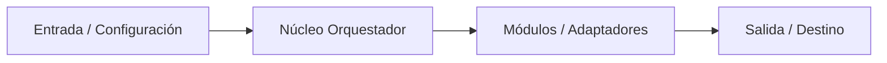

# Nombre del Proyecto

[](#)
[](#)
[](#)

Breve descripción funcional en una sola frase del propósito central del proyecto.

---

## Resumen Ejecutivo

Nombre del Proyecto es una plataforma/herramienta diseñada para resolver [problema central] mediante un enfoque [desacoplado / modular / performante]. Proporciona [capacidad clave 1], [capacidad clave 2] y una arquitectura extensible que permite [beneficio principal], aislando la complejidad técnica y optimizando la mantenibilidad operativa.

---

## Arquitectura Esencial



---

## Puesta en Marcha Rápida (Quickstart)

```bash
# 1. Configurar entorno y dependencias
export PATH="${HOME}/.local/bin:${PATH}"

# 2. Clonar el repositorio
git clone https://github.com/<owner>/<repo>.git && cd <repo>

# 3. Aprovisionamiento inicial
./build.sh

# 4. Verificación de salud estática
./build.sh check
```

---

## Interfaces y Comandos Principales

| Comando / Módulo | Descripción | Referencia Técnica |
| :--- | :--- | :--- |
| `build` | Compila directivas y artefactos de distribución. | [docs/cli.md](docs/cli.md#build) |
| `check` | Auditoría estática de integridad y presupuestos. | [docs/cli.md](docs/cli.md#check) |
| `status` | Reporta el estado operativo y dependencias activas. | [docs/cli.md](docs/cli.md#status) |

---

## Mapa de Documentación y Convenciones

- **Instalación y Entorno:** Consulta [docs/setup.md](docs/setup.md) para requisitos de SO, variables y resolución de incidencias.
- **Manual de Referencia CLI:** Consulta [docs/cli.md](docs/cli.md) para la referencia exhaustiva de subcomandos y banderas.
- **Diseño y Extensibilidad:** Consulta [docs/architecture.md](docs/architecture.md) para el modelo modular y schemas.
- **Decisiones Arquitectónicas:** Gestionadas en [docs/adr/](docs/adr/) bajo estándar MADR vía `adr-manager`.
- **Desarrollo Guiado por Issues:** Prohibido push directo a `main`; todo cambio se canaliza mediante ramas efímeras y Pull Requests vinculados a issues.
